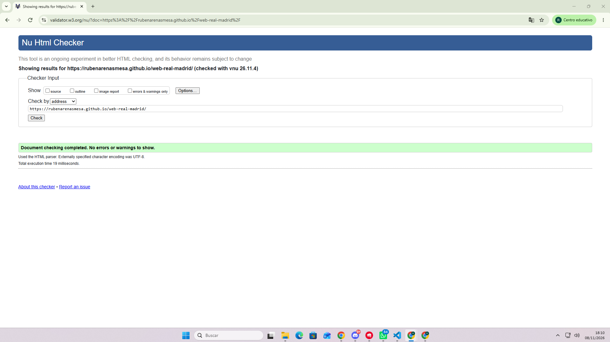
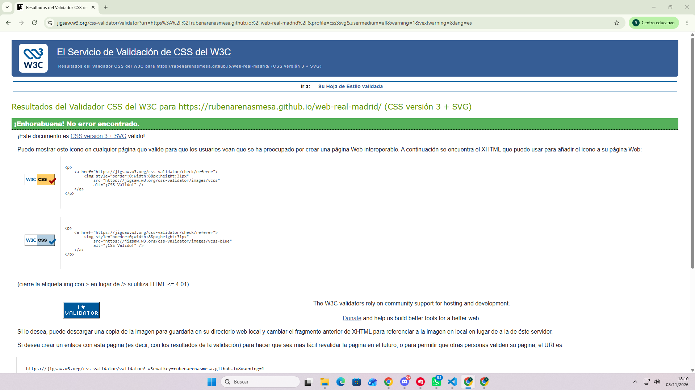
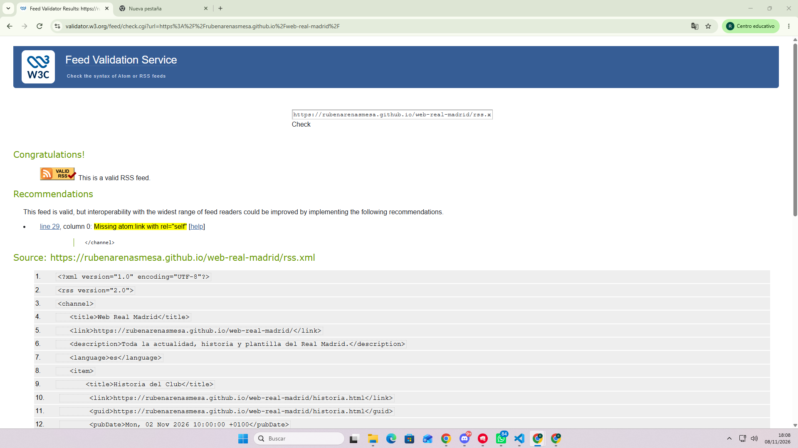

# Real Madrid | Pasión Blanca

Sitio web madridista compuesto por cinco páginas HTML5 hipervinculadas entre sí. Tiene un artículo sobre la historia de la 15 champions, una tabla con los jugadores destacados del primer equipo, una imagen del estadio, un video de las obras del estadio, el mapa donde se ubica el estadio, el himno de la décima y un formulario de solicitud para hacerse socio y un canal RSS. Proyecto realizado para la práctica de HTML5 del módulo de Lenguaje de marcas y sistemas de gestión de información.

## Autoría

- Nombre y apellidos: Rubén Arenas Mesa
- Curso: 1º DAM
- Módulo: Lenguaje de marcas y sistemas de gestión de información (LMSGI)
- Fecha: 10-11-2026 

## Sitio publicado

- Web en GitHub Pages: [Abrir sitio](https://rubenarenasmesa.github.io/web-real-madrid/)
- Repositorio: [Abrir repositorio](https://github.com/rubenarenasmesa/web-real-madrid) <!-- COMPROBAR que esta URL es la de tu repositorio -->

## Estructura del proyecto

```text
web-real-madrid/
├── index.html
├── historia.html
├── plantilla.html
├── estadio.html
├── noticias.html
├── rss.xml
├── README.md
├── css/
│   └── estilos.css
├── img/
├── audio/
├── video/
└── subtitulos/
```

- `index.html`: página principal. Presenta el sitio, muestra el logotipo y ofrece resúmenes con enlace a las demás páginas (Champions, plantilla, estadio y formulario).
- `historia.html`: artículo sobre el camino hacia la 15ª Champions, con elementos de bloque y de texto semánticos.
- `plantilla.html`: tabla con la información de los jugadores del primer equipo (dorsal, posición, nacionalidad), con `caption`, `thead`, `tbody`, `tfoot`, `colspan` y `rowspan`.
- `estadio.html`: galería de imágenes, audio y vídeo locales y contenido incrustado de Google Maps.
- `noticias.html`: formulario de solicitud para hacerse socio, con validación HTML.
- `rss.xml`: canal RSS 2.0 con los contenidos publicados en la página principal.
- `css/estilos.css`: hoja de estilos básica para las cinco páginas.

## Tecnologías utilizadas

- HTML5
- CSS
- XML y RSS 2.0
- Git
- GitHub
- GitHub Pages

## Características principales

- Navegación entre cinco páginas desde un menú común, con identificación de la página actual.
- Plantilla común (cabecera, navegación y pie) y contenido propio en `main` para cada página.
- Uso de HTML semántico: `header`, `nav`, `main`, `section`, `article`, `aside`, `footer`, `time`, `address`.
- Tabla accesible con estructura completa.
- Galería con imágenes en varios formatos (JPG, PNG), `figure` y `figcaption`.
- Contenido multimedia local (audio y vídeo) y contenido externo incrustado (Google Maps).
- Formulario con `fieldset`, `legend`, `label` y atributos de validación.
- Canal RSS enlazado desde el head y desde un enlace visible.
- Sin JavaScript.

## Validación

### HTML



### CSS



### RSS




## Dificultades encontradas


1. **Rutas de recursos que fallaban en GitHub Pages.** Ejemplo: una imagen se veía en local pero no en la web publicada por que no estaba haciendo el `git push`.
2. **Errores de validación en W3C.** Ejemplo: atributos mal escritos o elementos sin cerrar. Se resolvió leyendo los mensajes del validador, corrigiendo cada error y volviendo a validar.
3. **Funcionamiento de `rowspan` y `colspan` en la tabla.** Ejemplo: las celdas se desalineaban al combinar filas y columnas. Se resolvió eliminando la linia correspondiente al rowspan del siguiente jugador.

## Decisiones técnicas

- **Organización de archivos:** las páginas HTML están en la raíz y los recursos separados por tipo en `css/`, `img/`, `audio/`, `video/` y `subtitulos/`, con nombres en minúsculas y sin espacios.
- **Partes de la plantilla que se repiten:** cabecera con logotipo, menú de navegación con las cinco páginas, pie con autor, curso y año, y el enlace a la misma hoja de estilos.
- **Qué cambia en cada página:** el `title`, el `h1` y todo el contenido de `main`.
- **Formatos de imagen:** JPG para fotografías, PNG para imágenes con transparencia, PNG para logotipos, WebP por su buena compresión para web. 
- **Rutas relativas:** todos los recursos locales usan rutas relativas (por ejemplo `css/estilos.css`, `img/logo.png`), de modo que la web funciona igual en local y en GitHub Pages.
- **Preparación para CSS:** una única hoja `css/estilos.css` enlazada desde las cinco páginas

## Fuentes y licencias

| Escudo / logotipo | `img/logo.png` | Real Madrid C.F. | Uso educativo |
| Fotografías e imágenes | `img/estadio.jpg`, `img/champions.jpg`, `img/equipo.jpg` | Wikimedia Commons / Real Madrid | CC BY-SA / Uso educativo |
| Audio | `audio/himno.mp3` | YouTube / Real Madrid C.F. | Uso educativo |
| Vídeo | `video/remodelacion.mp4` | YouTube / Real Madrid C.F. | Uso educativo |
| Textos | `historia.html`, `estadio.html` | Elaboración propia y Wikipedia | CC BY-SA |
